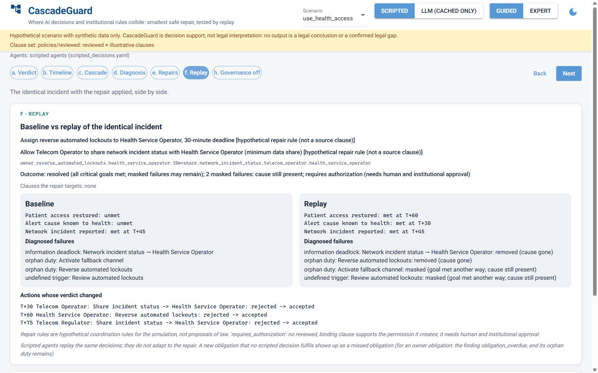
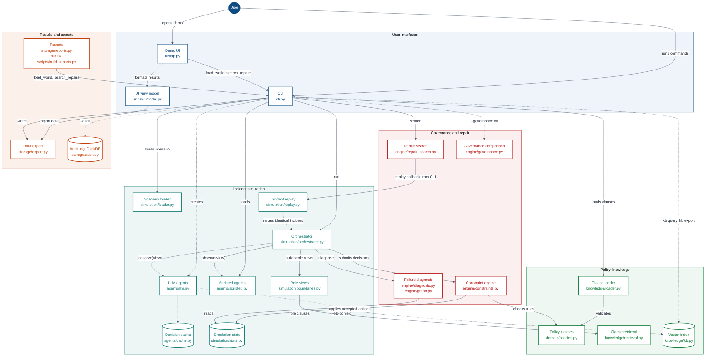

# CascadeGuard

Find where AI decisions and institutional rules collide, identify the smallest safe repair,
and replay the same incident to test whether the repair works.

Prototype for the ITU AI for Good Sandbox Hackathon (UAE). Decision support only: it does not
issue legal interpretations. All scenario data is synthetic. See `CascadeGuard.md` for the
concept.



▶ Demo video: [cascadeguard-demo.mp4](cascadeguard-demo.mp4)

## Submission

Submission for the ITU AI for Good Sandbox Hackathon (UAE).

**Technical report:** [docs/report/cascadeguard-report.pdf](docs/report/cascadeguard-report.pdf)
(Word: `docs/report/cascadeguard-report.docx`; source: `docs/report/cascadeguard-report.md`; the
PDF is built from the source with `uv run python scripts/report_pdf/build.py`).

| | |
|---|---|
| Team | GM of AI |
| Member | Ibrahim Melhem |
| Affiliation | Al Balqa Applied University, Faculty of Artificial Intelligence |
| Mentor | Dr. Wafaa Almaaitah |

## What it found

In the hypothetical `uae_health_access` scenario (synthetic data; clause set: reviewed +
illustrative clauses):

- **4 coordination failures diagnosed** (scripted agents): an information deadlock (network
  status to the health operator), two orphan duties and an undefined trigger. Each is a
  candidate gap for expert review, not a confirmed legal or standards gap (clauses behind each:
  [docs/gap-analysis.md](docs/gap-analysis.md)).
- **The rank-1 repair meets both critical goals, with the engine's checks in force** (scripted
  agents). It needs human and institutional approval: it creates a permission that no reviewed,
  binding clause in the loaded clause set supports.
- **2 masked items stay open for expert review:** in the scripted replay the incident resolves
  without settling who may activate a fallback channel or what triggers a review of an
  automated lockout.

## How it works

1. Six institutional roles are played by agents (scripted, or a live LLM); they only propose actions.
2. A deterministic engine, never an agent, accepts or rejects every action against the loaded clause set.
3. The engine diagnoses coordination failures: information deadlocks, orphan duties, undefined triggers.
4. Repairs come only from a closed grammar of five policy edit types, ranked deterministically.
5. Each repair is tested by replaying the identical incident and comparing it with the baseline.

## Architecture



A user starts a run from the CLI (`cli.py`) or the demo UI (`ui/app.py`); the UI loads the
scenario and searches repairs through the same CLI functions. The orchestrator
(`simulation/orchestrator.py`) advances the timeline, builds each role's boundary-filtered view
(`simulation/boundaries.py`) and asks that role's agent, scripted or LLM, for a decision. The
constraint engine (`engine/constraints.py`) checks every proposed action against the loaded
policy clauses and applies only accepted actions to the simulation state
(`simulation/state.py`); at the end, diagnosis (`engine/diagnosis.py`) names the coordination
failures. Repair search (`engine/repair_search.py`) screens candidate edits from the closed
repair grammar, replays the identical incident with each one (`simulation/replay.py`) and ranks
the results. The CLI writes exports (`storage/export.py`) and, with `--audit`, a DuckDB audit
log (`storage/audit.py`); `scripts/build_reports.py` builds the generated reports
(`storage/reports.py`).

Solid lines are used every time that path runs; dotted lines only with an optional flag or
command (LLM agents, `--kb-context`, `--audit`, `--governance off`, `kb query`/`kb export`).

## Quick start

Requires [uv](https://docs.astral.sh/uv/). Python 3.12 is installed by uv if missing. No API key
and no LLM calls: scripted agents are the default and give byte-identical output on every run.

```bash
uv sync                                                          # install (pinned in uv.lock)
uv run cascadeguard run uae_health_access                        # the incident, no repair
uv run cascadeguard repairs uae_health_access                    # search, replay and rank every repair
uv run cascadeguard run uae_health_access --repair <repair-id>   # replay with one repair (ids from repairs)
uv run python -m cascadeguard.ui.app                             # demo UI at http://localhost:8765
```

### Ask the Policy Adviser

Pause at any step and ask the Policy and Legal Adviser a question. It answers from its own view
at that step (no fact released later, nothing outside its information boundary) in seven
sections: direct answer, UAE evidence (clause id, source, page, verbatim quote), status labels,
an international comparison kept separate, the responsible role or "not established in the
reviewed corpus", permissible options and the required human escalation, and uncertainty. It
abstains when no loaded clause supports an answer. Only loaded clauses (reviewed or
illustrative) are citable; knowledge-base text is context only; not citable. The adviser has no
enforcement authority.

```bash
uv run cascadeguard ask uae_health_access --presets                       # the 6 preset questions
uv run cascadeguard ask uae_health_access --at T+30 "Who must activate the fallback channel?" --offline
```

The seven sections are always the engine's own text, built from the loaded clauses: with no API
key (no network; free-text questions use the keyword half of the search), and in LLM mode too.
In LLM mode (`--live`, with the three variables of `.env.example` set) the configured chat model
picks the clauses from the same evidence and writes a separate block, "Model commentary
(unverified agent statement)", after the seven sections. The engine checks the answer's
citations and structure (any problem: the template is shown, with the reasons) and the
commentary sentence by sentence: a sentence with gap, status or authority wording is withheld,
and the block says how many were withheld and why. Answers are cached in `data/adviser_cache/` and replayed
without `--live`. **`ask` calls a model only with `--live`** (per question: at most 4 chat
requests, and 1 query embedding, sent up to 4 times with retries); without it, even with a key,
it uses the cache or the template.

Preset answers: the configured model's answers to the six presets were recorded on 2026-11-06
(prompt adviser-v2, 6 chat requests) in `docs/evaluation/adviser/cache/`; replay with
`--cache docs/evaluation/adviser/cache` (the cache key includes the model id, so replay needs the
same `CASCADEGUARD_MODEL` in `.env`; no call is made). They were recorded on **keyword
retrieval**: embedding the preset questions failed (OpenRouter HTTP 502, 2026-11-05/06), so
`policies/kb/adviser_query_vectors.json` does not exist and the context chunks come from the
keyword half of the search. The engine accepted all six answers; their commentary is shown with
1 to 8 sentences withheld each (18 in all; see `docs/evaluation/adviser/README.md`). If the
presets are embedded later, their context changes and the recorded answers no longer match.
Every answer names its mode. `--export DIR` writes the full trace; `--audit` records it in
DuckDB. In the UI the panel is under the timeline (step b): its live-call switch is off by
default and shows only when `OPENROUTER_API_KEY` is set, with at most 20 live questions per
session; any failed live call falls back to the template, labelled. Agents in the UI stay
cache-only. The adviser's answer is a separate, read-only advisory channel
(`docs/decisions/0003-adviser-advisory-channel.md`).

## Knowledge base and Sources

| What | Where |
|---|---|
| Original sources | `policies/sources/` (SHA-256 and status in `docs/policy-inventory.md`) |
| Cited clauses | `policies/reviewed/*.yaml` (verbatim text, file, page, status; human approvals in `policies/approvals.yaml`) |
| How clauses are extracted and reviewed | `docs/policy-methodology.md` |
| Vector index (context only) | `policies/kb/` (chunks, vectors, manifest; built by `scripts/build_kb.py`) |
| Which documents and clauses the agents cited | [`docs/citation-map.md`](docs/citation-map.md) (scripted and live runs; built by `scripts/citation_map.py`) |

**Vector knowledge base (context only, never citable).** `policies/kb/` holds the same pages the
keyword search covers (extracted text outside the excluded sources, plus the reviewed Charter
transcriptions), split at numbered headings into chunks of at most about 120 words and embedded
with `nvidia/nemotron-3.5-embed-1b:free` through OpenRouter's embeddings endpoint (1,024
dimensions). Search fuses cosine similarity over the committed vectors with the keyword search
(reciprocal rank fusion; tied scores share a rank), at most two chunks per document, exact
duplicates shown once with the pages that repeat them; only the query is embedded, which
needs `OPENROUTER_API_KEY` and
`OPENROUTER_BASE_URL` (free model, no cost). Each chunk shows its file, page and label, and any
reviewed clause whose quote it holds, with that clause's own status label.

```bash
uv run cascadeguard kb query "human oversight of AI decisions" -k 3
uv run cascadeguard run uae_health_access --agents llm --offline --kb-context  # LLM context only
uv run cascadeguard kb export data/export_kb_main.jsonl
```

The export writes every chunk with its vector and string metadata in a ChromaDB-compatible
format that the ITU reference code's ingestion loads into its `kb_main` collection
(`get_or_create_collection` with cosine distance, then `add` with the pre-computed embeddings).
ChromaDB is not needed to run CascadeGuard; the test that loads the export uses the optional
extra: `uv sync --extra chroma`. The scripted demo and the keyword search never use the API.

### Sources

The documents in `policies/sources/` belong to their issuers and are used here for research
only; official sources:

| File | Issuer | Official source |
|---|---|---|
| `5 AI RMF Core - Excerpt from the NIST AI Risk Management Framework 1.0 (2023)..pdf` | NIST | [doi.org/10.6028/NIST.AI.100-1](https://doi.org/10.6028/NIST.AI.100-1) |
| `887026278-TDRA-Telecom-Law-Final-English-o.pdf` (and its OCR copy) | UAE; consolidated text by TDRA | [u.ae](https://u.ae/-/media/Resources/TDRA-telecom-law_Final_english_o.pdf) |
| `AI-Adoption-Guideline-in-Government-Services-Eng.pdf` | UAE AI Office / Ministry of Cabinet Affairs | [moj.gov.ae](https://www.moj.gov.ae/assets/b170a9de/ai-report-en-v7-638538011662280996.aspx) |
| `AIGuide_EN_v1-online.pdf` | UAE National Program for AI | Official source not located yet |
| `Dubai Law No. (26) of 2015.pdf` | Government of Dubai | [dlp.dubai.gov.ae](https://dlp.dubai.gov.ae/Legislation%20Reference/2015/Law%20No.%20(26)%20of%202015.html) |
| `EU AI Act, Regulation (EU) 2024-1689.pdf` | European Union | [eur-lex.europa.eu](https://eur-lex.europa.eu/eli/reg/2024/1689/oj) |
| `Federal Decree by Law No. (45) of 2021 Concerning the Protection of Personal Data.pdf` | UAE (federal) | [uaelegislation.gov.ae](https://uaelegislation.gov.ae/en/legislations/1972/download) |
| `GDPR-Regulation (EU) 2016-679.pdf` | European Union | [eur-lex.europa.eu](https://eur-lex.europa.eu/eli/reg/2016/679/oj) |
| `Health Data Protection and Confidentiality Policy_EN2022810559.pdf` | Dubai Health Authority | [dha.gov.ae](https://www.dha.gov.ae/uploads/082022/Health%20Data%20Protection%20and%20Confidentiality%20Policy_EN2022810559.pdf) |
| `MOCAI-AI-Ethics-EN-1.pdf` | UAE Minister of State for AI | [u.ae](https://u.ae/-/media/AI-publications/MOCAI-AI-Ethics-EN-1.pdf) |
| `OCED-Towards a common reporting framework for AI incidents.pdf` | OECD | [oecd.org](https://www.oecd.org/en/publications/towards-a-common-reporting-framework-for-ai-incidents_f326d4ac-en.html) |
| `Responsible-Metaverse-Self-governance-Framework-2023-EN.pdf` | UAE AI Office (Agile Nations working group) | [u.ae](https://u.ae/-/media/Documents-2nd-half-2023/Responsible-Metaverse-Self-governance-Framework-2023-EN.pdf) |
| `T-AI4G-AI4GOOD-2025-6-PDF-E.pdf` | ITU | [itu.int](https://www.itu.int/pub/T-AI4G-AI4GOOD-2025-6) |
| `T-REC-Y.3172-201906-I!!PDF-E.pdf` | ITU-T | [itu.int](https://www.itu.int/ITU-T/recommendations/rec.aspx?rec=13894) |
| `UAE Federal Law No. 2 of 2019. The Use of ICT in Health Fields..pdf` | UAE (federal) | [uaelegislation.gov.ae](https://uaelegislation.gov.ae/en/legislations/1209/download) |
| `UAE Policy Foundation.pdf` | Unofficial compilation of u.ae policy pages; Charter part: UAE AI Office | [u.ae (Charter)](https://u.ae/en/about-the-uae/strategies-initiatives-and-awards/policies/Ai/The-UAE-Charter-for-the-Development-and-Use-of-Artificial-Intelligence) |
| `The UAE Charter for the Development and Use of Artificial Intelligence.pdf` | UAE Minister of State for Artificial Intelligence, Digital Economy & Remote Work Applications Office | [u.ae (Charter page)](https://u.ae/en/about-the-uae/strategies-initiatives-and-awards/policies/Ai/The-UAE-Charter-for-the-Development-and-Use-of-Artificial-Intelligence) (the page the PDF was obtained from was not recorded) |
| `UAE-National-Strategy-for-Artificial-Intelligence-2031.pdf` | UAE Government | [u.ae](https://u.ae/-/media/AI-publications/UAE-National-Strategy-for-Artificial-Intelligence-2031.pdf) |
| `OECD_Recommendation_AI.pdf` | OECD Council (OECD/LEGAL/0449) | [legalinstruments.oecd.org](http://legalinstruments.oecd.org) (as printed in the PDF) |
| `UNESCO Recommendation on the Ethics of Artificial Intelligence.pdf` | UNESCO General Conference | SHS/BIO/PI/2021/1 (no URL printed in the PDF) |
| `UAE_National_Cybersecurity_Strategy.pdf` | Telecommunications Regulatory Authority (TRA era; undated) | Official source not located; historical context, superseded by the 2025 National Cybersecurity Strategy |
| Two published books (not committed; context only) | Abhivardhan (BPB); Bullock, Chen et al. (eds., OUP) | [bpbonline.com](https://bpbonline.com/products/artificial-intelligence-ethics-and-international-law-2nd-edition); [academic.oup.com](https://academic.oup.com/edited-volume/41989) |

The seven files in `policies/sources/web/` are transcriptions of official web pages, printed to
PDF, not the original documents; each is unverified until checked against the official page
(details in `policies/sources/web/MANIFEST.md`):

| File | Issuer | Official source |
|---|---|---|
| `web/01_uae_smart_health_ai_policy.pdf` | Ministry of Health and Prevention (lead entity, as printed) | [uaelegislation.gov.ae](https://uaelegislation.gov.ae/en/policy/details/national-policy-for-the-promotion-of-smart-health-services-and-artificial-intelligence-in-the-uae-health-sector) |
| `web/02_uae_international_ai_policy.pdf` | UAE Government (lead entity not printed on the page) | [uaelegislation.gov.ae](https://uaelegislation.gov.ae/en/policy/details/uae-s-international-stance-on-artificial-intelligence-policy) |
| `web/03_uae_national_cybersecurity_strategy.pdf` | UAE Cabinet (approval announcement); also transcribes the WAM launch report | [uaecabinet.ae](https://uaecabinet.ae/en/news/uae-cabinet-approves-national-cybersecurity-strategy-api-first-policy); [wam.ae](https://www.wam.ae/en/article/bi5dfsr-uae-launch-national-cybersecurity-strategy) |
| `web/04_uae_digital_government_strategy_2025.pdf` | UAE Government (u.ae portal; issuing entity not printed) | [u.ae](https://u.ae/en/about-the-uae/strategies-initiatives-and-awards/strategies-plans-and-visions/government-services-and-digital-transformation/uae-national-digital-government-strategy) |
| `web/05_uae_ai_government_policies.pdf` | UAE Government (u.ae portal; issuing entity not printed) | [u.ae](https://u.ae/en/about-the-uae/digital-uae/digital-technology/artificial-intelligence/artificial-intelligence-in-government-policies) |
| `web/06_unesco_ai_ethics_recommendation.pdf` | UNESCO (superseded by the official original above) | [unesco.org](https://www.unesco.org/en/artificial-intelligence/recommendation-ethics) |
| `web/07_oecd_ai_principles.pdf` | OECD (superseded by the official original above) | [oecd.org](https://www.oecd.org/en/topics/sub-issues/ai-principles.html) |

## Developer notes

Rules for coding agents are in `AGENTS.md`; current status and hand-off notes in `PROGRESS.md`.

**Where things are**

| What | Where |
|---|---|
| Concept and requirements | `CascadeGuard.md`, `specs/` |
| Scenario, roles and expected outputs | `scenarios/uae_health_access/` |
| Architecture | `docs/architecture.md`, `docs/decisions/` |
| Evaluation | `docs/evaluation/` |
| Submission readiness audit | `docs/submission-readiness.md` |

**Pinned outputs.** The result of `run uae_health_access` is pinned in
`scenarios/uae_health_access/expected_baseline.yaml` (checked by
`tests/integration/test_real_baseline.py`); the ranking from `repairs uae_health_access` in
`scenarios/uae_health_access/expected_repairs.yaml` (checked by
`tests/integration/test_repairs.py`).

**Governance off (comparison only, never the result).**
`uv run cascadeguard run uae_health_access --governance off` shows the governed run beside an
ungoverned one: actions the engine rejects only for authority, a clause restriction or a missing
prerequisite or information are applied and listed as "would have been rejected". The UI shows
it at step h.

**Exit codes:** 0 done; 2 refused, not configured or stopped outside a live run (e.g. a missing
variable, no request cap); 3 a live LLM run that is inconclusive (a step with no decision
because the request cap ran out or a request failed, or the run stopped part-way at the
provider's daily limit or a knowledge-base failure). Offline and scripted runs never exit 3.

**Generated documents.** Generated from the engine with scripted agents
(`uv run python scripts/build_reports.py`): the gap analysis (`docs/gap-analysis.md`; its example
mapping was reviewed at gate 7 on 2026-10-31: six entries approved, two removed) and three
example traces (`docs/evaluation/traces/`, with `how-to-read.md`). The gate-4 live LLM recording
is in `docs/evaluation/gate4/`.

**LLM agents.**

```bash
uv run cascadeguard run uae_health_access --agents llm --offline # LLM agents, cache only (Phase 5)
```

Scripted agents are the default and need no key. LLM agents (`--agents llm`; in the UI only
"LLM (cached only)", which reads the decision cache and never calls the API) read `OPENROUTER_API_KEY`, `OPENROUTER_BASE_URL` and `CASCADEGUARD_MODEL`
from `.env` (see `.env.example`); there is no default model, and the model must support
structured outputs (`response_format` with `json_schema`). Live calls cost money; decisions are
cached in `data/llm_cache/` and replays reuse them. `scripts/llm_smoke_test.py` makes exactly
one call.

**Demo UI.** The demo UI runs at http://localhost:8765. Set `CASCADEGUARD_UI_PORT` to use
another port.

**Checks.**

```bash
uv run ruff check . && uv run ruff format --check . && uv run pyright && uv run pytest
```

The browser smoke test (`tests/e2e`, marker `e2e`) needs Chromium once:
`uv run playwright install chromium`. Skip it locally with `uv run pytest -m "not e2e"`;
CI always runs it. The UI timing budgets (spec 006: paint < 1.5 s, clicks < 200 ms; median of 5
after one warm-up, a click over budget re-measured once and failing only if both medians are
over) are marked `perf`: they run in the full check, CI applies
`CASCADEGUARD_PERF_FACTOR=3`, and `uv run pytest -m "not perf"` skips them locally.

## Licence

The code and documentation are under the MIT licence (`LICENSE`). The documents in
`policies/sources/` are not: they belong to their issuers (see Sources). The knowledge base's
chunking and `kb_main` export layout are adapted from the ITU AI Readiness simulation
([CrashingGuru/ITUAIReadiness](https://github.com/CrashingGuru/ITUAIReadiness), MIT,
Copyright (c) 2026 Vishnu Ram OV).
